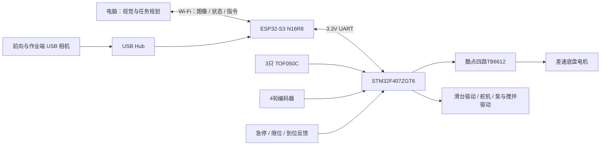
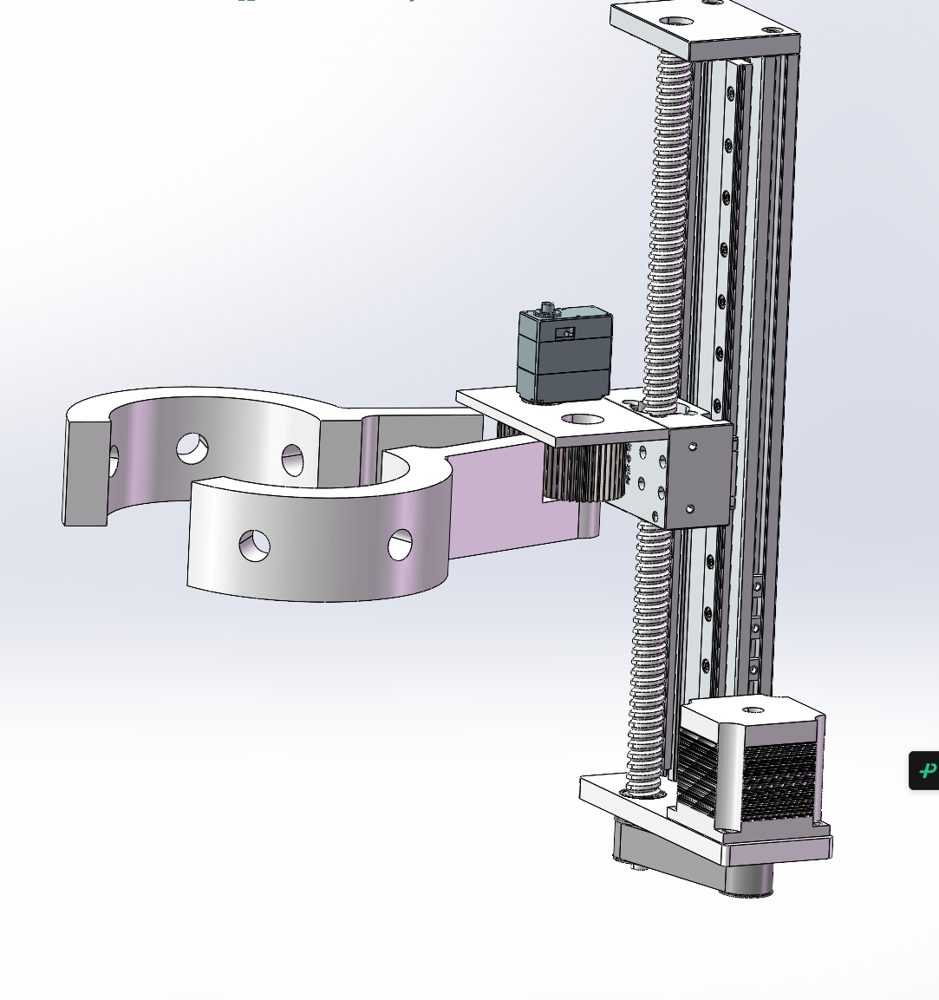

# 树木涂白机器人

面向城市道路沿线树木的侧置环抱式涂白机器人。当前以自建缩比场景验证定位、环抱、升降与喷涂流程，后续再评估实际道路适用性。

> **阶段快照：2026-11-05。** 已完成总体方案讨论并采购底盘、控制与部分感知部件；其余执行部件仍在选型。尚未完成整机装配和闭环作业验证。2026-11-08新增底盘无线遥控测试代码，验证范围见测试记录。本文中的设计值、商品参数和实测结果分别标注，不能把已采购理解为已经验证可用。

## 底盘遥控测试（2026-11-08新增）

已提供[电脑浏览器→S3→F407→TB6612测试程序](firmware/remote_control/README.md)和[完整接线表](firmware/remote_control/WIRING.md)，含前进、后退、左右转向及超时停车。当前是开环台架测试版，尚未上车验证；不包含喷涂与自动避障。

## 当前方案

- 双层四驱差速底盘，普通轮；下层放电池和控制板，上层布置搅拌容器及待选泵。
- 升降立柱固定在底盘下层的**侧面**，滑动平台通过固定长度连接件连接双半环夹爪，不使用水平伸缩机构。
- 双半环由单舵机和一对齿轮同步开合；夹爪内径100 mm、外径140 mm、高50 mm，计划安装6个喷嘴。
- STM32F407ZGT6负责本地运动控制与联锁；单块ESP32-S3 N16R8负责无线通信、相机采集转发和STM32通信。
- 前向90°、作业端70°两台720P USB相机；3只TOF050C分别用于树干近距测量与作业范围两侧检测。相机与测距数据送电脑处理，电脑下发作业指令。
- 双相机以**按作业阶段分时采集**作为初始设计。单块S3接Hub的兼容性、实际分辨率和帧率尚待验证。

TOF接入方式、急停和执行驱动等仍待补齐；上图为设计连接关系，不是已经完成的接线图。

## 文档导航

|文档|内容|
|---|---|
|[背景与需求](docs/01-requirements.md)|作业场景、缩比范围、指标与边界|
|[机械结构](docs/02-mechanical.md)|双层布置、侧置滑台、环抱与喷涂、打印细节|
|[电气与供电](docs/03-power.md)|电池、驱动板5.3V警告、负载与配电|
|[控制与网络](docs/04-control-network.md)|F407/S3/电脑分工、双相机和无线验证|
|[感知与定位](docs/05-perception.md)|前方树干距离估计、障碍检测、涂白效果|
|[通信与固件设计](docs/06-protocol.md)|命令、状态机、超时、OTA规划|
|[资源与引脚草案](docs/07-resources.md)|定时器、串口、引脚冲突与扩展|
|[测试与里程碑](docs/08-validation.md)|到货检查、分系统到整机的验收步骤|
|[采购明细](docs/09-procurement.md)|已下单14条明细，合计703.70元；待采购清单|
|[决策与风险](docs/10-decisions.md)|方案演变、尚未解决的问题|
|[资料来源](docs/references.md)|厂商资料索引与官方技术依据|
|[早期汇报](reports/2026-11-03/README.md)|历史PPT，不能替代当前设计|

## 目前最需要验证的事项

1. 实购酷点驱动板注意事项称外接“5V”输出约5.3V，并警告不可直接接外设芯片5V脚。必须核实实物、电路版本和目标板输入规格，不能沿用其他品牌板的供电结论。
2. 用户提供的电机参数表含3.5A堵转电流，超过TB6612芯片相应峰值条件；实购电机需核对型号和实测启动负载，不能依靠接口匹配判断驱动匹配。
3. S3原生USB为Full Speed。两台USB相机、Hub、主机供电及软件驱动需要实机验证；不承诺两路720P/30fps同时传输。
4. 单个侧向测距值是到树皮表面的距离，不是树干中心距离；前向单目图像也不能在未知尺寸时直接给出绝对距离。
5. 侧悬机构的重量、偏载、夹爪打开后的通行包络，以及非横移底盘的入位/离位轨迹，尚未验证。

## 文件范围与授权

本仓库发布设计说明、脱敏采购清单和现有设计截图；新增底盘遥控测试源码与构建方法；整机自动作业固件和视觉上位机尚未完成。原始订单、账号、地址、支付记录、完整厂商软件包和安装程序不公开。商品价格仅记录本次采购，不代表现价。

公开仓库不等于已选择开源许可证；当前暂未指定项目许可证。第三方图片和资料归原权利人所有，见[来源说明](THIRD_PARTY.md)。
