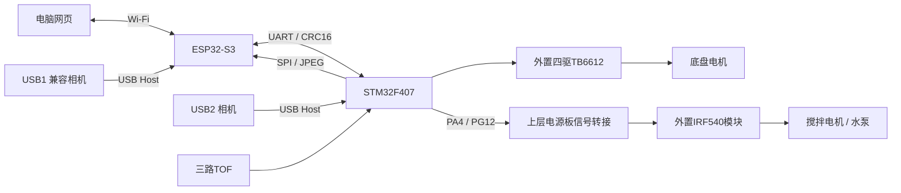

# 树木涂白机器人

侧置环抱式树木涂白机器人项目。STM32F407负责本地执行控制与三路TOF，ESP32-S3负责Wi-Fi、USB相机与板间通信，电脑网页用于当前阶段的人工联调。

**当前源码：`0.5.5-dual-usb-spi`。** V4.2 四层板使用 `pcb_v2`。实车最近一次验证的 ESP32 版本为 `0.5.4-dual-usb-spi`。团队从[开发交接说明](docs/15-v42-team-handoff.md)开始。

相机 1 由 ESP32 的 USB Host 采集，需使用兼容相机。STM32 采集相机 2 并通过 SPI 转发给 ESP32。
## 从这里开始

|任务|入口|
|---|---|
|接线、刷两端程序、测试泵/搅拌/相机/TOF|[现板联合测试说明](firmware/remote_control/BENCH_TEST_20261120.md)|
|STM32源码|[main.c](firmware/remote_control/stm32/App/main.c)、[TOF驱动](firmware/remote_control/stm32/App/tof.c)|
|ESP32源码和网页|[RemoteControl](firmware/remote_control/esp32/RemoteControl/)、[ESP-IDF构建入口](firmware/remote_control/esp32/idf/)|
|GPIO唯一配置|[pinmaps.json](firmware/board_profiles/pinmaps.json)、[pcb_v2接线](firmware/board_profiles/WIRING_PCB_V2.md)|
|当前PCB、制板和BOM|[PCB版本导航](hardware/pcb/README.md)|
|SolidWorks、STEP和打印STL|[机械模型导航](hardware/mechanical/README.md)|
|本轮测试记录|[固件测试](firmware/remote_control/TEST_REPORT_20261120.md)、[机器可读结果](firmware/remote_control/validation/20261120/results.json)|
|变更与设计决策|[CHANGELOG](CHANGELOG.md)、[决策记录](docs/10-decisions.md)|

## 已实现的联调功能

- 四驱差速底盘网页开环遥控，保留启用会话、停止、超时停车和OTA维护锁。
- 搅拌器CH1=PA4、水泵CH2=PG12，网页独立开关，**高电平通电、低电平关闭**；STM32返回GPIO输出指令状态。CH3/4预留，固定关闭。
- 三只TOF050C/VL6180X分别使用独立软件I²C：PC0/PC1、PD11/PD12、PC4/PC5；错误与过期读数单独标记。
- USB1 接 ESP32-S3 的 GPIO19/20，USB2 接 STM32F407 的 PA11/PA12。现有 `0C45:6367` 相机已实测在 USB2 出图。
- ESP32网页OTA保留，维护时关闭底盘、上装和相机；STM32 OTA、滑台/夹爪自动动作、整机自动作业与视觉定位闭环尚未实现。



网页热点：`TreeRobotTest`，测试密码`TreeTest2026`。控制页`http://192.168.4.1/`，相机/测距页`/sensors`，升级页`/update`。设备独立OTA密码由本地构建配置生成，不在仓库中。切换窗口会使控制页停止并锁定。

## 构建与验证

```powershell
python firmware/board_profiles/generate.py --check
python firmware/remote_control/tools/test_core.py
node firmware/remote_control/tests/test_web.mjs
python firmware/remote_control/tools/build_stm32.py --profile pcb_v2
python firmware/remote_control/tools/build_integrated.py --profile pcb_v2
```

STM32使用本地Keil ARM Compiler 5和ST HAL/CMSIS；USB整合版使用ESP-IDF5.4.2、Arduino3.2.1组件和固定的UVC源码。工具链路径可通过脚本参数指定，第三方SDK需要按[来源记录](firmware/sensor_test/SOURCES.md)准备。首次构建会生成网页头文件、公共代码副本和本地OTA配置。构建不自动烧录。

编译后STM32文件位于`firmware/remote_control/stm32/build/pcb_v2/`，ESP32文件位于`firmware/remote_control/esp32/build/integrated/pcb_v2/`，烧录地址见联合测试说明。预编译固件含设备本地OTA配置，保留在本地交付包，本次不上传公开仓库。

## 目录

```text
firmware/                 两端程序、网页、公共协议、测试与构建脚本
hardware/pcb/             当前V4.2原生工程、生产文件、BOM与预览
hardware/mechanical/      当前机械交付的整理副本
docs/                    需求、电气、控制、感知、采购与设计工具说明
software/                后续上位机规划
reports/                 已公开的阶段汇报索引
```

详细设计：[需求](docs/01-requirements.md) · [机械](docs/02-mechanical.md) · [供电](docs/03-power.md) · [控制网络](docs/04-control-network.md) · [感知](docs/05-perception.md) · [协议规划](docs/06-protocol.md) · [验证](docs/08-validation.md)。历史文档按日期保留；现板实际针序和程序行为以本页所链的联合测试说明与`pcb_v2`为准。

公开内容包括项目源码、自建CAD/打印模型、当前PCB工程与可公开BOM。原始订单、设备凭据、厂商完整资料、安装程序、SDK、构建缓存及旧版大备份留在本地。本次整理不删除原目录，不新增实物验证结论。项目尚未指定开源许可证，第三方资料说明见[THIRD_PARTY](THIRD_PARTY.md)。
