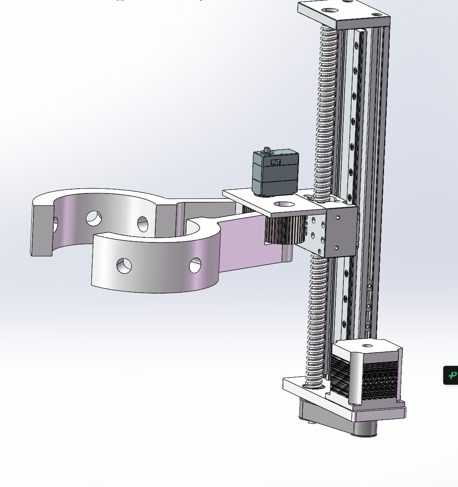
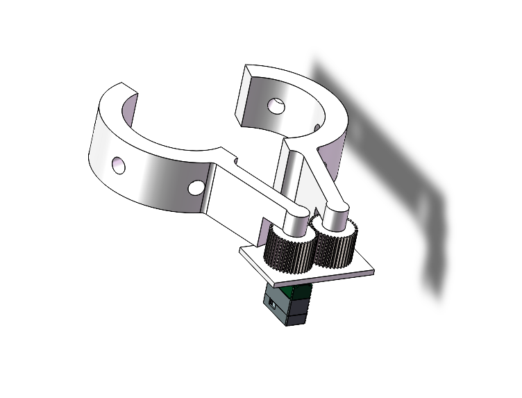
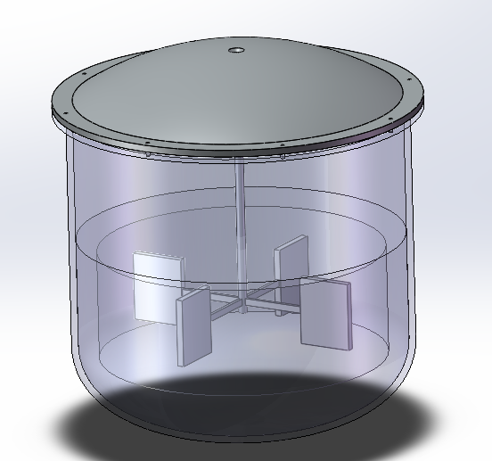

# 机械与喷涂结构

## 总体布置

下层布置电池、F407、S3、驱动和保险/配电，电池尽量靠低位并与侧置机构形成合理配重。上层放搅拌容器和泵，使用防漏托盘、固定带与独立检修空间。电控不能放在液路接头正下方；软管和线束留升降余量并做拉力释放。

升降立柱位于车身侧面，底座固定在下层底板上；增加与立柱相连的支撑/加强件，把侧向弯矩分散到多个固定点。亚克力避免只靠单个小孔承受偏载，使用垫片和背板分散应力，必要时局部采用金属加强件。液体晃动、满罐和滑块最高位均需检查。

这是现有CAD截图，不是带公差、材料和完整尺寸的制造图。目前没有可公开的原始CAD/STEP/STL文件，后续应补充。

## 升降和连接

候选180 mm滑台由17HS4401和TB6600驱动。TB6612仅驱动车轮，不驱动该步进滑台。选型时核对丝杆导程、有效行程、整套质量、竖直额定负载、悬臂允许力矩、安装孔及是否存在掉电回落。

固定长度连接件连接滑台滑块和环抱总成，不配置主动水平伸缩。连接件尽量短，采用加强肋、圆角和可更换安装孔，避免横向长悬臂。设置上/下限位、机械止挡和安全回零流程；仅靠步数不能确认未丢步。水平安装时的商家承载指标不能直接当竖直偏载能力。

## 环抱和开合

两半环内径100 mm、外径140 mm、高50 mm，合计6个喷头孔。单舵机驱动一侧齿轮，再通过另一齿轮反向同步转动两半环。环抱是定位喷涂空间，不以挤压树干获取定位。

齿轮设计输入为模数1、40齿、厚30 mm。标准直齿条件下分度圆直径40 mm，两相同齿轮名义中心距40 mm；压力角、变位、实际轴距、齿侧间隙和打印误差仍需在CAD确认。齿轮与支承轴应独立承载，舵机轴避免直接承担夹爪全部悬臂载荷。

打开至180°为目标描述，不代表舵机180°指令就产生两半环各180°开度；应定义每半环角度、传动比和机械限位。检查整个开合轨迹、线管弯曲和喷头凸出空间。

候选舵机为众灵ZP15S-C磁编码单轴总线舵机，厂家表称15KG级、360°、5～12V；未采购，扭矩单位、额定电压下连续扭矩、堵转电流、串口电平与协议必须以准确型号资料为准。“15KG”不能解释为夹爪承重15 kg。以最不利开合阻力和摩擦核算扭矩，软限位与机械止挡双重限制，避免长期顶死。

净通行内径会被喷头、毛刷和防护件减小，不能直接按100 mm匹配树径。设环内有效直径D、树径d、树心偏差e、机械余量m，则应满足 e ≤ (D-d)/2-m。树径未知时先由视觉估计范围并检查兼容性；大冗余并不会自动对中。

## 喷涂和搅拌

喷嘴候选为02号、80°扇形、1/4直通，共6个，尚未完成采购和适用性验证。早期直径10 mm、长23 mm为旧描述；1/4螺纹不等于6.35 mm安装孔径，需以实物螺纹和配件CAD设计孔位。

供应商选型图02号孔径0.91 mm；1、2、3 bar下单嘴清水流量分别约0.46、0.64、0.79 L/min，六嘴合计约2.76、3.84、4.74 L/min。0.5 bar处未给数值，不能补猜。实际石灰浆/涂料黏度和颗粒会改变喷形和堵塞风险。

这个流量对小模型储液量偏大，优先做单嘴试验，比较间歇喷、分组喷和更小流量方案，再定泵。泵需同时满足工作压力下总流量、涂料兼容、过滤和清洗需求；不能用零压力最大流量直接匹配。按泵类型设置适用的调压/回流，避免不允许堵转的泵长期憋压。

六个喷嘴沿周向分布，扇面方向和喷距通过试喷决定。应在停止供料后再打开夹爪；需要时增加兼容的截止阀防滴漏。保留刷子作为可拆卸试验件，是否使用由均匀性和阻力试验决定。

搅拌容器拟3D打印，可拆盖、底部叶片、密封轴套；搅拌电机与容积待定。打印件先做静置漏水、轴封和清洗验证，再测试涂料兼容性。泵和搅拌需要各自驱动及续流/抑制措施，不能占用已用于四轮的TB6612通道。

## 打印和承载建议

连接件、环抱装置和搅拌结构拟3D打印，尚无打印验收记录。承载件按层间受力方向布置，增加壁厚与局部加强，优先机械紧固和螺纹嵌件；轴、螺栓和必要轴承使用金属。材料耐温、耐水和涂料兼容性需实测，不把“尽量塑料”解释为所有受力件只能塑料。

整机质量表需统计底盘、打印件、滑台、控制、液体和电池。侧翻核算以整机重心投影相对轮胎支撑多边形为依据，最高滑台、最远开爪和最大装液量均要验证；尚不能承诺2.5 kg有效载荷。
