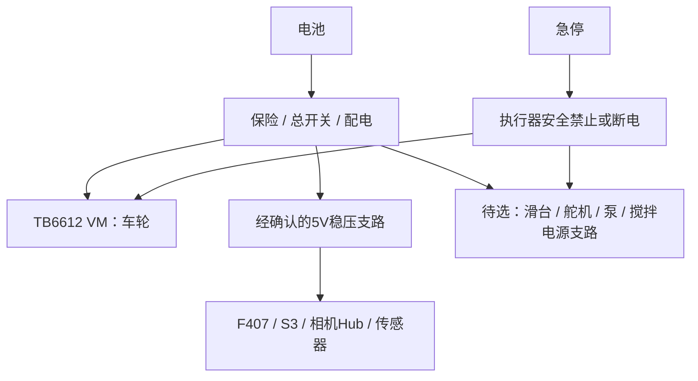

# 电气、供电与电机驱动

## 已采购电池

订单SKU为“12V【5000mAh】DC公母头配1A充电器”，57元。供应商截图同容量档标称约305 g、55×37×70 mm、持续8A、瞬间20A；这些是商家参数，未做容量/放电实测。12.6V表格通常对应3串锂电体系，但实际化学体系、保护板、截止电压和充电器输出仍需到货核验。

充电器1A是充电规格，不是电池只能输出1A。DC公母头的具体尺寸、极性和允许电流需实测/确认；不要未经核对把另一插头名称当成兼容电源口，也不要把12V直接接ESP32的5V/3.3V或传感器引脚。

## 实购酷点TB6612板的特别说明

实际资料来源见[资料索引](references.md)，不能直接套用早先参考的WHEELTEC板。

- 四路版本原理图包含两颗TB6612FNG、TMI3255S降压和AMS1117-3.3；图上降压输出标为5V/3A。
- 厂家《0-驱动器使用注意事项～使用前必读》明确写：“驱动器预留的4路5V输出电压≈5.3V”，并警告不可直接连接外设芯片5V引脚。
- 其他接线说明又描述可给外设供电，存在措辞冲突。公开图纸也不等于实物版本完全相同，因此必须核对板版本、实测空载/负载电压，并向商家确认实际允许连接的负载。
- 多个5V接口通常共用同一电源，总额定值不能按接口数量相乘。原理图标称3A不是本项目已验证持续输出能力。

因此当前**不把驱动板5V直接供整套控制、相机和传感器作为已确认方案**。如所有目标板输入规格及满载稳定性明确兼容，才评估复用；否则使用准确稳压的独立5V降压支路。独立支路是待选备选，不是已购清单中的部件。

## 推荐配电草案

所有信号连接需要共同参考地；大电流回路避免经控制板细地线返回。配置合理保险、主开关、连接器和线径；执行器支路与逻辑支路分配去耦。急停回路需按最终驱动使能和电源切断结构设计，不能仅依赖网络指令。避免将两个5V电源直接并联或由USB口反向供电。

F407核心板是否可从某输入端接12V，必须按其具体输入范围、稳压芯片和散热验证；即便有宽压入口，也不代表所有插座允许12V。统一经已验证5V输入供电通常便于调试，但具体接点须对照板图。

## 四轮驱动的电流匹配

实购底盘SKU为12V 320rpm编码器电机。用户所给参数表在减速比30档称：空载320rpm、额定180rpm、空载电流≤0.16A、额定电流≤1.2A、堵转3.5A；表中型号文字为520，与底盘“305系列”名称不能直接画等号，需到货确认真实电机型号。

TB6612FNG数据表的平均1.2A和峰值3.2A属于绝对最大额定值，其中3.2A为10ms单脉冲条件，不能作长时间工作目标。若该3.5A堵转参数确实适用于实物，则超过相应峰值条件，启动、卡轮和原地差速转向均需评估。依据：[东芝官方资料](https://toshiba.semicon-storage.com/ap-en/semiconductor/product/motor-driver-ics/brushed-dc-motor-driver-ics/detail.TB6612FNG.html)。

四轮按1.2A相加为4.8A只用于粗略预算，不是常态实测；按3.5A同时堵转则14A，更不能把电池峰值和驱动峰值理解为可长期堵转。厂家同时提示本板适合小于1A的小电机，建议PWM不长期满占空比。必要时降低负载和加速度，仍不满足则更换具备足够电流裕量的驱动。

本板没有已确认的四路电流测量，不得声称软件已实现真实电流闭环限流。过流保护需要硬件能力和实测配合，保险不替代电机驱动限流。

## 容量和供电验证

5000mAh优先兼顾重量和模型续航。假设电池侧平均2～4A、仅按70%标称容量可用，则估算约50～100分钟；这只是算式5Ah×0.7/I，没有包含未定泵、滑台等的完整实际工况，不作为续航承诺。

先测待机、S3无线发送、双相机枚举、单轮启动、四轮低速转向等工况的电压和电流。再加入上装，检查峰值压降、复位、温升与接头发热，确认后再决定是否需要更大电池或独立降压。先用限流电源调试，电机架空验证方向，再落地低速。
