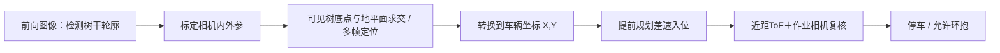

# 感知、树干定位与作业范围检测

## 现有采购与布置

|设备|数量|建议位置与用途|状态|
|---|---:|---|---|
|720P90° USB相机|1|朝前并偏向树列，提前识别下一棵树|已购，视场定义和近焦待验|
|720P70° USB相机|1|环抱装置上方，观察树干对中和可见涂白表面|已购，安装高度/角度待定|
|TOF050C|1|侧向或可见树干处，提供近距离表面测距|已购，实际协议及性能待验|
|TOF050C|2|环抱开合扫掠范围的前后/两侧监测|已购，具体安装需按机构包络设计|

早先超声波加两只普通红外是历史候选，不能再列作已采购部件。用户提供的选型图为050F/200F/400F，订单是050C；未经准确模块资料确认，不能把050F的全部参数移植给050C。

## 提前估计树到车的垂直距离

以车辆行驶方向为x、朝树列方向为y。需求是下一棵树心在车辆坐标系的y距离，既不是斜向距离，也不是车到树皮的距离。若已获得树心平面坐标(X,Y)，则侧向距离为|Y|，再减去已标定的车辆/夹爪安装偏置得到对中偏差。

未知树间距和树径时，单张单目图像的树干宽度或中心像素无法唯一确定绝对距离。不能用固定树径或固定间距做隐藏前提。当前可低成本尝试：

1. **平地、可见树底点的缩比场景**：标定相机和地面平面，树干轮廓中点附近的落地点由像素射线与地面求交，估计平面位置，再通过近距ToF复核。树池边缘、遮挡和相机俯仰变化都会引入误差；轮廓落地点也只是树心近似。
2. **多帧观测**：结合车辆编码器位移跟踪同一树，利用多视几何估计距离，再以有效ToF校正尺度/偏差。需要标定和可靠关联；打滑和树干圆柱曲面会影响结果。不是现成已实现算法。
3. 若树底不可见、多帧不稳定，则需要能直接提供深度的传感方式，如扫描测距或深度相机，属于后续成本备选。

侧向固定ToF通常要等树进入其视场才能得到有效数据，不能独自完成“斜前方任意下一棵树”的提前距离估计。若要用斜向测距，须已知光轴角度、安装偏置并确认命中树干，再换算表面点坐标；圆柱曲面和未知半径使它仍不等于树心。

## 近距定位与冗余

ToF报告到反射表面的距离，需要相机树干轮廓/对称性或其他几何约束才能估计中心。环内100 mm只是名义尺寸，须扣除喷头、刷毛和结构余量。先用足够小的树模型验证容错窗口，再逐步扩大直径范围，记录每次成功入位偏差，不把任意尺寸都能适应作为目标。

50cm是商家宣称最大量程，不能由夹爪10cm直接推断必然够用：需要测传感器到目标的实际最近/最远距离、盲区和光斑覆盖。若确认为VL6180系列，ST资料说明基础测距0到100mm以上，扩展距离取决于条件；“50cm高精度稳定”不应作为芯片保证。依据：[ST官方VL6180X资料](https://www.st.com/en/imaging-and-photonics-solutions/vl6180x.html)。

三只相同模块需确认UART/I2C电平、默认地址、改址能力。地址冲突时可以独立UART，或增加I2C复用器；不能假定模块一定引出了XSHUT。光学串扰可尝试分时触发并实测。外壳加防溅罩，但窗口材料与污染对测距的影响需要验证。

## 障碍检测边界

两只单点ToF只能覆盖各自视锥，不构成完整二维或三维保护区。根据夹爪整个运动轨迹布置，使检测区域覆盖最可能碰撞方向；安装高度不应只覆盖树心而漏掉低处障碍。目标树本身也会触发距离，应对允许的树干区域建立有限容许条件，不能把整个作业侧屏蔽。

闭合前连续检查障碍值与有效性；作业中遇到异常或无效测距停止底盘、泵和危险动作，记录原因，再决定安全恢复，不能盲目自动张开。急停与限位在本地执行。此方案仅供受控模型实验，不具备已认证的人体防护能力。

## 喷涂效果评价

作业端相机划定树干ROI，排除背景、夹爪、喷头和过曝区，基于颜色/亮度统计可见覆盖比例，尽量固定曝光、白平衡和照明，并与人工标注比较。镜头靠近树干时要做最近对焦实测；商品早期表中60cm调焦距离不代表当前SKU能拍清几厘米处。

单台作业端相机只能评价可见表面，不能证明背面或全周覆盖，也不能直接测涂层厚度、防虫或生物效果。如需全周评估，应增加离线多角度拍摄或转动树模型采集，不能把局部白色比例称为全树合格率。
