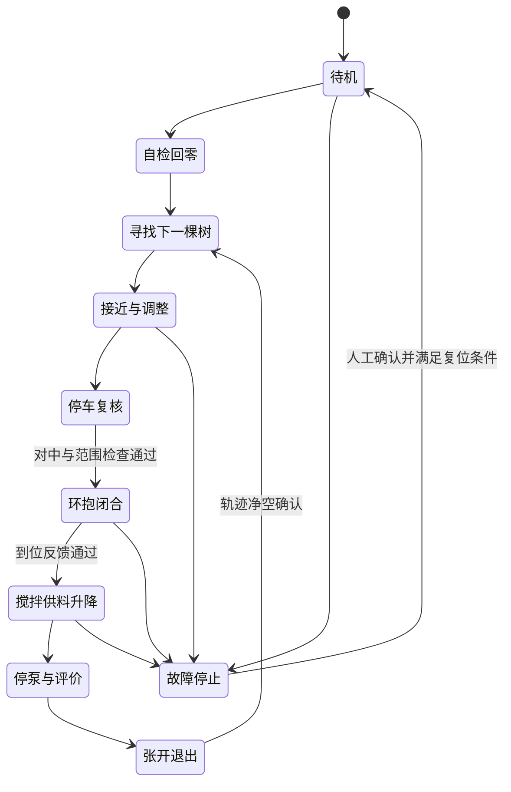

# 固件、协议与作业状态机草案

> 本文是整机协议规划。2026-11-08新增[底盘遥控测试程序](../firmware/remote_control/README.md)，采用其中注明的固定12字节子集协议；整机功能仍待实现，未完成硬件联调。

## 实时任务

F407周期采集编码器并做四轮速度闭环，以定时器生成PWM；滑台通过定时器输出脉冲并由上下限位约束。主循环或RTOS任务处理传感器、通信、状态机和显示。中断内只做必要采样/入队，避免等待网络或长时间阻塞。

S3通过USB Host获取MJPEG帧，按阶段切换相机，网络任务转发最新图像；单独维护控制接收、串口转发和心跳。图像缓存数量有上限，满时淘汰旧帧。视频连接故障、S3复位和电脑断开不能使F407保持无限期运动。

## 协议建议

F407与S3串口初始可用115200 8N1做控制验证，再按实测增加速率。图像不经该串口。帧格式建议：帧头、版本、类型、序号、载荷长度、载荷、CRC16；限定最大长度，串口DMA环形接收，支持错帧重新同步。CRC多项式、字节序和编码方式必须在实现前冻结。

网络指令包括cmd_id、序号、有效期和参数；S3转发时保留身份与过期信息，F407以本地接收计时确认是否超时。跨设备绝对时间戳只有时钟同步后才可用于判断年龄，不能直接比较不同设备开机时间。

|命令类别|拟保留接口|约束|
|---|---|---|
|底盘|设速度、停止、查询编码器|速度/加速度限制，禁止过期命令|
|作业机构|回零、升降目标、开合|限位、到位和障碍联锁|
|供料|泵开关/占空比、搅拌开关|未进入允许状态不得喷涂|
|提示|屏幕内容、语音编号、LED|故障提示优先于普通提示|
|诊断|传感器有效值、状态、故障、版本|区分无效测距与真实零距离|
|配置|有限范围阈值/标定参数|校验范围和版本，不直接开放任意GPIO|

命令应有接收确认与执行完成/失败两类反馈；重复cmd_id不能重复启动一次性动作。停车/取消命令最高优先级。故障锁存后需明确复位条件，恢复通信不自动续喷。

## 状态机

任意危险运动状态都应支持急停/故障转移，图中仅画代表性路径。动作完成靠反馈与超时判断，不能完全依靠固定延时。整体沿树列向前，不代表普通轮能横向平移；需要规划实际差速可行的入位与离位路径。

## OTA与维护

S3可规划网络OTA及回滚分区，更新时先停车、停泵并禁止任务。F407通过S3更新需自行设计IAP引导程序、Flash分区、包校验和掉电恢复；仅串口连接不会自动具备无线升级能力。不能把芯片ROM bootloader等同现有应用IAP。保留ST-LINK/SWD与本地恢复方式，先有线稳定运行再开发OTA。

扬声器和LED/显示屏仍待选型：语音可通过独立串口音频模块触发，屏幕优先考虑SPI接口并控制刷新量。扬声器不可直接接MCU引脚驱动，电源和功放另核算。
