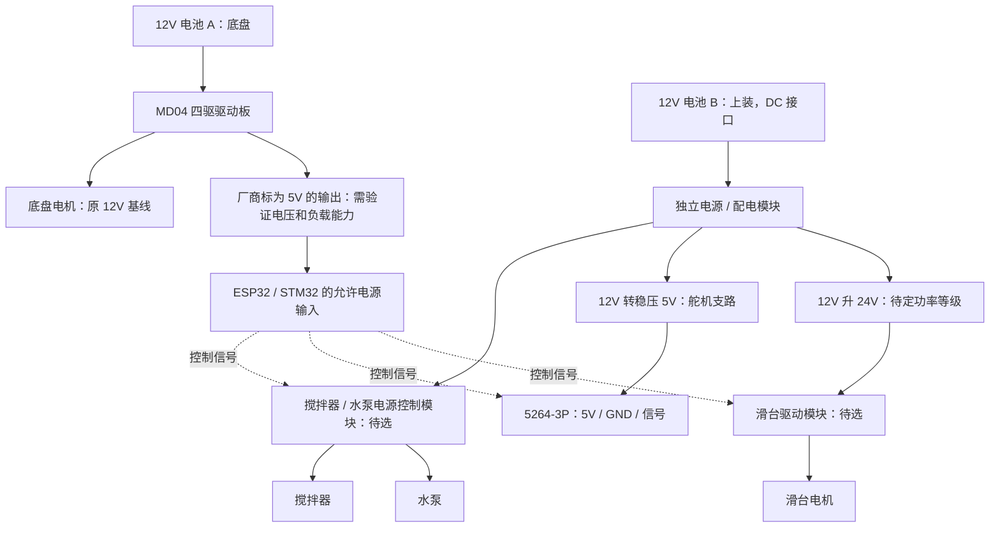

> **已由后续确认和 V2 工程覆盖。** 用户随后授权完成 PCB；DC 母座已定为 5.5×2.1 mm，舵机针序为 I/O、5V、GND，滑台电机为 28HS30-0604A-013。两块板、固件 pcb_v2 和详细接线已生成，当前状态见 [V2 检查记录](../hardware/pcb/robot_electronics_v2/CHECKS.md)。本页下文是早期需求快照，其中“暂不设计、不改 GPIO、另做舵机 5V 降压”等内容不再作为当前要求。当前按用户指示从 MD04 的 5V 供逻辑和舵机，未新增 5V 降压。

# 2026-11-13 用户修订：控制载板、独立电源板与滑台升压

状态：仅记录需求和供电可行性，不开始新 PCB 的原理图、封装、布局、布线或选型定稿。本记录覆盖先前与其冲突的布局、3D 和供电要求；旧工程保留作历史样板，不表示已完成本次修订。

## 用户已明确的要求

1. **调整 MD04 四驱电机驱动板位置。** 现版放侧边、接口朝外会使电池连接不便。后续须为电源插头和线缆保留车内空间，不沿用“右侧边缘、接口向车外”的既定位置；具体坐标和朝向未定。
2. **重新评估并缩小控制载板。** 当前 200×280 mm 对用户而言偏大。不能仅以小于 230×305 mm 底板为合格依据，应按实际模块、接插件操作空间和原始底板图纸可用固定孔重新确定尺寸；本次不预设新长宽。继续避开电机、编码器及电机下方不可用的孔。
3. **补齐其他模块的 3D 模型。** 最新要求覆盖此前“只绑定排针排母，不绑定 STM32/ESP32”的指令。后续至少补 STM32、ESP32、MD04 等已纳入装配的模块，配合连接器一起检查插头朝向、碰撞和线缆空间。无原厂模型时才按有依据的尺寸建简化模型，标明来源和近似范围。未选型模块不虚构外形。
4. **使用两组独立 12V 电池。** A 供底盘驱动板；用户希望底盘驱动板的 5V 输出给 ESP32、STM32 供电。B 供上装执行器的独立电源板，用户描述的电池接口是 DC 口。接口尺寸、极性和持续/瞬态电流待核实；不能默认任意 DC 插座均能承受总负载。
5. **上装配电另做模块，不并入控制载板。** 由该电源板接收 B 电池，再分配给搅拌器、水泵、滑台驱动及舵机供电支路。用户希望升压功能也在这个独立模块内评估。
6. **舵机接口为 5264-3P，三条功能线是 5V、GND、信号。** “三个接口”按一个三针接口的三种功能记录，接口数量尚未指定。不把叙述顺序自动冻结为插座 Pin1/2/3。实际针距、键位、配套端子及针序依据采购件确认。舵机 5V 由上装 12V 的独立降压支路提供，不把 12V/24V 接到该 5V 针，也不占用主控板的小电流 5V 引脚供舵机动力。
7. **搅拌器和水泵使用一个电源控制模块；滑台控制模块尚未选定。** 前者的型号、通道数、是否要求两负载独立开关及电流能力待明确；不能提前当作继电器或 MOSFET 模块定型。后者须按滑台电机类型和控制要求选型，历史 17HS4401/TB6600 仅是候选。
8. **24V 指滑台电机。** 用户已进一步明确，不是底盘四个 520 电机。底盘不因这条消息改成 24V；TB6612 不接升压后的 24V。滑台为步进、直流有刷或其他类型尚待明确。
9. **当前不改 GPIO、接线配置或固件。** 日后若模块/引脚变更，仍须同步固件统一配置源、所有衍生头文件、接线表和 PCB 网络，不能只改图纸。

## 供电关系：需求与待验证条件

这是供电功能关系，不是已完成的电路设计。两个电池的正极不直接并联。若各模块通过非隔离信号连接，控制和驱动必须有正确公共参考地，并规划大电流回流路径；不能靠细信号地线承担上装回流。两路不同来源的 5V 也不直接并联。

原有三只 ToF 的 3.3V 接口、独立 3.3V 生成及两组 USB Hub 下行口连接要求继续有效。它们的电源预算须在新布局时重算，用户本次没有确认相机/Hub 改由哪一路供电。

### 底盘驱动板的“5V”不能只按标签判断

本地厂商原文：`硬件资料/(MD02&MD04)酷点TB6612电机驱动器/0-注意事项必看/0-驱动器使用注意事项~使用前必读.txt` 第 12 条称四路 5V 输出约 5.3V，并禁止直接接外设芯片 5V 引脚。四驱原理图另标 5V/3A，见 [供电资料](03-power.md)。

因此记录为“**用户希望采用的主控供电路径，待验证**”：依据实物版本核对两块开发板正确的供电入口、最大允许输入、电机启停时的纹波/压降和总负载。若不满足输入规格，就需要调节、稳压或更换准确 5V 的来源；不能在需求记录中把 5.3V 自动改写成已经验证的 5.0V。电脑 USB 调试仍需避免反灌和两路 5V 并联。

## 12V 升 24V 的可行性评估

**原则上可以，并可以放在独立上装电源模块中评估；目前不能确定芯片、模块功率或连接器电流等级。** 升压 24V 应接滑台驱动器的电源输入，由驱动器接电机。若是步进电机，必须区分驱动母线电压、线圈相电压和限流值，不能把 24V 直接加到任意绕组上。

按功率平衡估算：

`I_battery ≈ P_slide_driver_input / (V_battery × boost_efficiency)`

以下仅为算例，非滑台实测或选型结果：假设 24V 端实际从电源取 2A，则输出功率 48W；效率按 90% 假设，在 12V 输入时约需 4.44A，电池带载降到 10V 时约需 5.33A。转换损耗约 5.33W，还要考虑散热。这里的 2A 是 24V 电源端电流，不是步进驱动器显示的单相电流。电池的总电流还须加上泵、搅拌器和舵机支路。

选型前需要：

- 滑台电机型号、驱动类型、配套驱动器允许母线范围、额定和峰值输入功率；有刷电机还需启动/堵转电流，步进系统需相电流、驱动设置及实际母线功耗。
- 带实际机械负载的启停、升降、加减速工况；确认是否存在制动回馈，需要何种母线过压处理。普通单向升压不能预设为能够吸收回馈的电源。
- B 电池的实际电压范围、BMS 持续/峰值电流、DC 插头/插座型号极性和电流能力，以及各执行器是否同时动作。
- 升压连续能力、短时峰值与持续时间、欠压/过流/过温保护、散热和配电回路额定。不能仅按商家“最大功率”标称决定是否可用。

本次不把“3.5A 堵转”等底盘电机历史参数套到滑台电机，也不预先选定所谓 100W/150W/200W 升压模块。

原厂技术依据：[TI 升压功率级计算 SLVA372D](https://www.ti.com/lit/an/slva372d/slva372d.pdf)；[东芝 TB6612FNG 手册](https://toshiba-semicon-storage.com/info/TB6612FNG_datasheet_zh_cn_20141001.pdf?did=30692&prodName=TB6612FNG)（正常 VM 上限 13.5V，绝对最大值 15V，不能接 24V）。

## 后续状态

等待用户继续明确滑台型号/驱动和上装各负载参数后再做电源预算与选型。控制载板缩小、MD04 移位和整模块 3D 装配检查均是待办，**本记录不代表已经修改工程、生成新 Gerber 或更新程序**。
