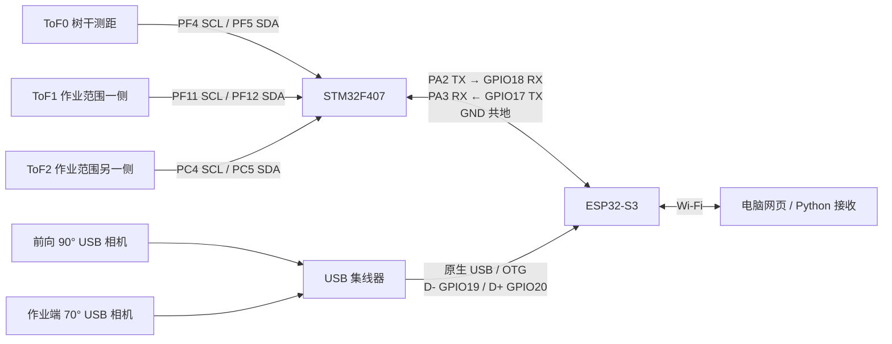

# 摄像头与测距模块接线 · 2026-11-10

本文表格为当前 `legacy` 杜邦接线。新PCB的测距引脚使用可选 `pcb_v1` 配置，见[新旧对照及编译选择](../board_profiles/WIRING_PCB_V1.md)。两种配置共用生成的引脚头文件；当前车不能直接使用新PCB配置。

此接线同样适用于[原工程整合版](../remote_control/INTEGRATED.md)。下文“独立传感器测试固件持续发送 STOP”仅描述独立诊断版；整合版保留正常遥控。

适用：已购正点原子 STM32F407ZGT6 最小系统板、ESP32-S3 N16R8、两台 USB UVC 摄像头、三只 **TOF050C / VL6180X / I²C** 测距模块。按实物丝印接线，不按商品照片左右位置判断。

## 1. 总体连接

测距模块接 STM32，图像直接进 ESP32；图像不经过两板串口。三只相同地址模块分别接三组独立软件 I²C，不需要改地址，也不要把三组 SDA/SCL 并在一起。

## 2. 三只 TOF050C：每只四根线

|模块引脚丝印|ToF0 树干测距|ToF1 范围一侧|ToF2 范围另一侧|
|---|---|---|---|
|VIN / VCC|STM32 的 3V3|STM32 的 3V3|STM32 的 3V3|
|GND|STM32 GND|STM32 GND|STM32 GND|
|SCL / SCL-TX|**PF4**|**PF11**|**PC4**|
|SDA / SDA-RX|**PF5**|**PF12**|**PC5**|
|INT|不接|不接|不接|
|SHUT / XSHUT|不接|不接|不接|

仅在实物为资料中的 I²C 版本时按此接；引脚上的 RX/TX 复用标识不表示本程序使用串口。本版地址为 7 位 **0x29**（线上写地址 0x52、读地址 0x53）。不要把这些线接到 ESP32 的 RX/TX。

- 先只接 ToF0，测试成功后再接另外两只；没接的模块允许显示总线错误。
- 以 **3.3V 供电**开始。模块表中最大工作电流每只 40mA，三只按 120mA 预留；确认 STM32 板上 3.3V 稳压余量。若另设 3.3V 电源，接模块 VIN 与共地，不并联两路稳压输出。
- SDA/SCL 空闲应被拉到约 3.3V。模块若无上拉，每根线可配一只 4.7kΩ 上拉至 3.3V；已有上拉先不叠加。杜邦线先保持 10–20cm，远离电机线。
- PF4/PF5/PF12 与板载外部存储器复用：本工程已令 **PG10 高电平、禁用 FSMC**；不要另行运行 SRAM 初始化。PF11 可能与外接 TFT 触摸接口复用，测试时不装 TFT/LCD。不要使用先前猜测的 PG0–PG5 排针。
- 本测试不使用 INT/SHUT；不要自行把 SHUT 接 5V。

## 3. 两板串口：沿用现有三根线

|ESP32-S3|STM32F407|说明|
|---|---|---|
|**GPIO17 TX**|**PA3 RX**|ESP32 → STM32|
|**GPIO18 RX**|**PA2 TX**|STM32 测距 → ESP32|
|GND|GND|必须共地|

115200、8N1、3.3V TTL。两块板各自 USB 供电时，只共地，不再把两板 5V 或 3V3 互连。STM32、ESP32 的电脑 USB 串口不是这条板间 UART。

原有 TB6612 电机线不需要调整，见[原电机接线表](../remote_control/WIRING.md)。首次传感器测试建议断开电机 VM 电源；本 ESP32 测试固件持续发 STOP，也没有 ARM/DRIVE 网页接口。

## 4. USB 摄像头与集线器

1. 两台相机的 USB 插头 → 集线器两个 USB 下行口。
2. 集线器 Type-C 上行插头 → ESP32-S3 的 **原生 USB / OTG** 插口。
3. ESP32 的另一个 **COM / USB-UART / CH343** 插口 → 电脑，用于供电、烧录和串口日志（115200）。
4. 原生 USB 的 GPIO19/20 保留给 USB，不能再接传感器；集线器不接 STM32。

**先核对 Host 角色和 VBUS，不能只看插头能否插入。** 本地附带的 S3 COREBOARD V1.4 参考原理图含 USB VBUS 的 0Ω 配置连接，并画有 Type-C CC 下拉；它不能证明实购板已配置 Type-C Host 供电。普通 Type-C 集线器上行口往往需要对端提供 Host 的 CC/5V 条件。固件把 USB 控制器设成 Host，并不会自动改电阻或产生 5V。

推荐使用有明确 **ESP32-S3 USB Host 接线说明、可给外设提供 5V、具备电源隔离/防反灌** 的接法。如果直插不枚举，应先排查板上 VBUS/CC 与转接线，而不是立刻改程序。不要在没有核对原理图时短接焊盘或把外接 5V 直接并到电脑 USB 的 5V。

给两台相机和 Hub 准备稳定 **5V 电源支路**，可按 5V/2A 作为台架起点，最终按两台实物相机铭牌、Hub 和板子总电流核算。使用有独立电源且明确不会向上行反灌的 Hub，或有隔离供电的 Host 转接板；不能仅凭“带供电口”判断支持此接法。不要默认开发板小型 3.3V 稳压器可以供相机，也不默认 TB6612 板上 5V 可承受全部负载。

若需要裸线转接，信号对应为 USB D-→GPIO19、D+→GPIO20、GND→GND，VBUS 按经核对的 Host 电源方案连接。USB 数据线必须使用短的 USB 屏蔽/双绞线，不能用长杜邦线代替。12V 不得接 USB VBUS。

## 5. 测试距离与安装

本地示例使用 VL6180X 的原始单字节毫米结果。本固件沿用该初始化方式，**未实现倍数扩展量程**；不能把商家“最高 50cm”当作这版已验证量程。先以白色平面目标在 **30、50、80、100mm** 测试，再试模拟树干。0–20mm 属模块标称盲区，本版判无效；黑色、斜面、细圆柱与强光均需实测。

三只采用轮流单次测量，减少同时发射造成的干扰；没有目标、量程错误和通信超时均返回无效，不会返回“0mm 可通行”。读取的是**传感器光学参考面到目标表面距离**，不是树干中心到车辆的距离。传感器安装偏置、树干视觉中心及夹爪中心仍需标定。两侧点式 ToF 也不能覆盖整个夹爪运动空间。
